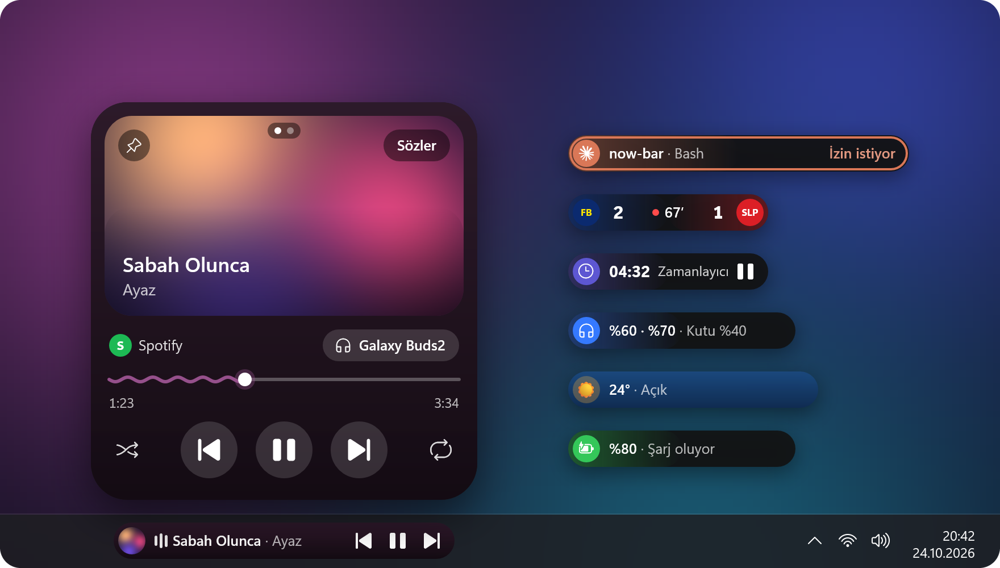
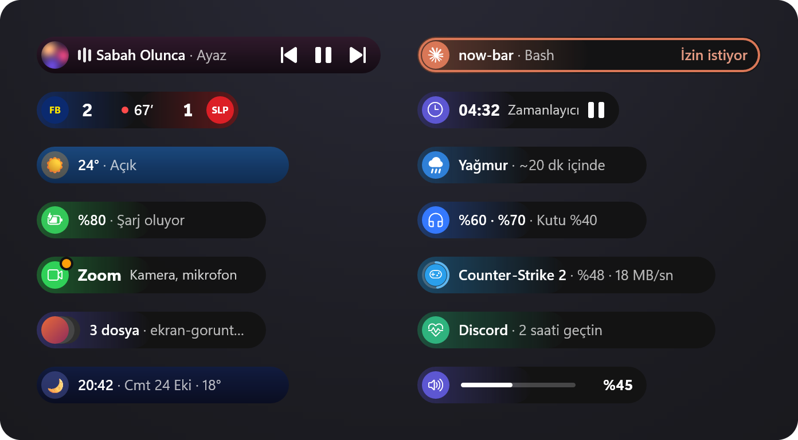
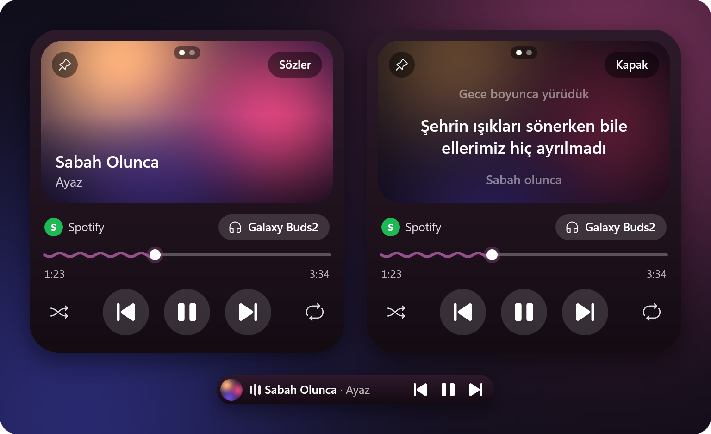
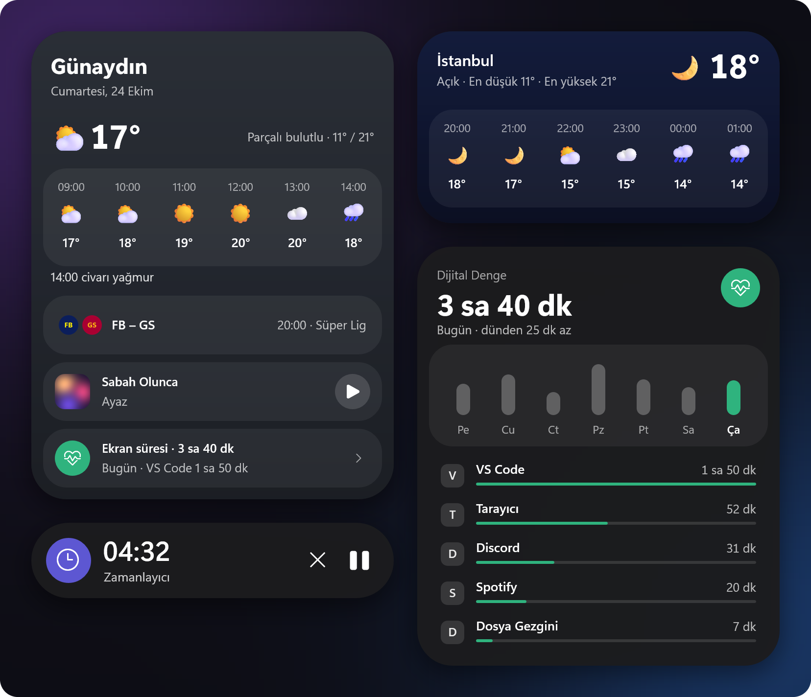
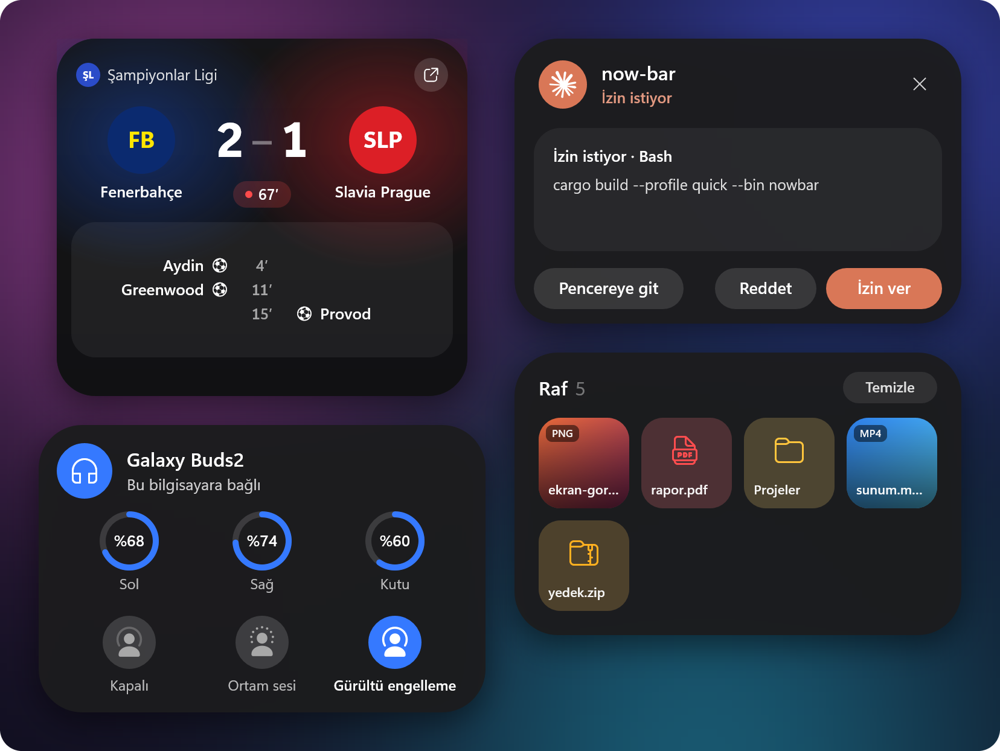
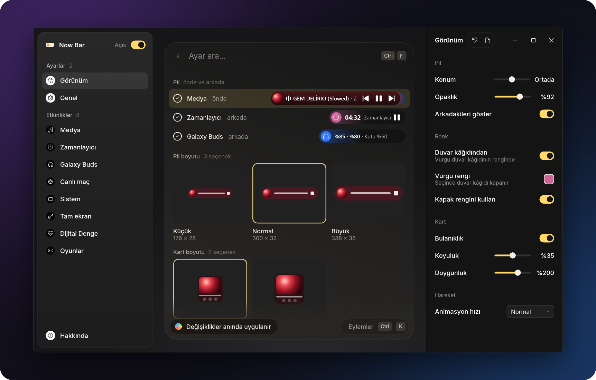
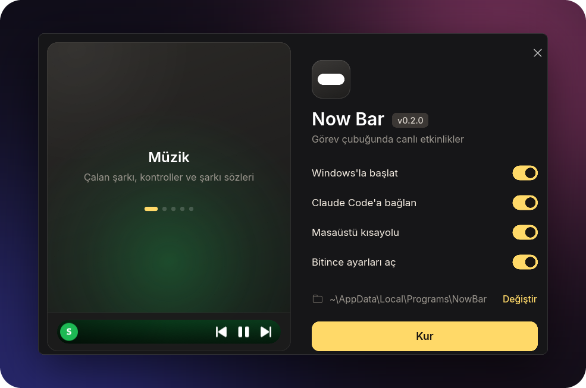

<div align="center">



# Now Bar

**Samsung One UI'ın Now Bar'ı, Windows 11 görev çubuğunda.**

Görev çubuğunda küçük bir pil durur ve o an olanı gösterir: çalan şarkı, zamanlayıcı, maçın skoru,<br>
Claude Code'un ne yaptığı. Tıklayınca üstünde bir kart açılır.

**[İndir](https://github.com/nixesty/now-bar/releases/latest)** &nbsp;·&nbsp;
[Neler gösterir](#neler-gösterir) &nbsp;·&nbsp;
[Kurulum](#kurulum) &nbsp;·&nbsp;
[Derleme](#derleme)

<sub>One UI's Now Bar in the Windows 11 taskbar. The app speaks Turkish and English.</sub>

</div>

<br>

## Neler gösterir



- **Müzik:** Windows'un medya oturumlarından gelen her şey (Spotify, YouTube Music, tarayıcılar).
  Pil kapağın renginde; kartta kapak, dalgalı ilerleme çubuğu, şarkı sözleri ve ses çıkışı seçici.
- **Zamanlayıcı ve kronometre:** seçiciden (Win+Alt+N) ya da tepsi menüsünden başlar; süre
  dolunca alarm çalar, kart açılır.
- **Canlı maç:** takip ettiğin futbol ve basketbol takımlarının skoru, dakikası ve gol anları.
- **Hava durumu:** boşta saat ve hava; yağmur, kar, fırtına, kuvvetli rüzgâr, aşırı sıcak, don ve
  hava kalitesi için uyarı. Şehir seçilmezse Windows'un konumundan bulunur.
- **Galaxy Buds:** sol, sağ ve kutu pili, gürültü kontrolü. Birden çok Buds varsa ayarlardan seçilir.
- **Claude Code:** Claude'un o an ne yaptığı, görev listesi; izin isteyince kartta
  **İzin ver / Reddet** ([aşağıda](#canlı-etkinlikler)).
- **Oyunlar:** Steam ve Epic Games indirmeleri, güncellemeleri, duraklatmaları ve oyun süresi.
- **Dijital Denge:** günün ekran süresi, uygulamaların payı ve koyduğun sınırlar.
- **Raf:** pile sürüklenen dosyalar orada bekler, sonra istediğin yere sürüklenir; yeni ekran
  görüntüleri kendiliğinden eklenir.
- **Sistem:** ses seviyesi, şarj ve düşük pil, mikrofon ya da kamerayı kullanan uygulama,
  Bluetooth kulaklıklar.
- Birden çok şey varsa öndekinin sağında ince şeritler görünür; pilin üstünde tekerlek, aralarında
  gezer. Oyun, video ya da sunum tam ekrandayken pil gizlenir; acil anlar (Claude'un izin isteği,
  hava uyarısı) oyunun üstünde küçük bir adada çıkar.

## Kartlar



Kart pilden büyür, fare uzaklaşınca geri küçülür. Müzik kartında kapağın köşesindeki **Sözler**
şarkı sözlerini açar; sözler `lrclib.net`'ten gelir ve şarkıyla birlikte akar.



Boştayken saate tıklamak günün özetini açar: hava, maçlar, son çalan şarkı ve ekran süresi.



## Ayarlar



Tepsi menüsünden **Ayarlar…** açılır; her değişiklik görev çubuğundaki pile anında uygulanır. Ayar
arama çubuğu ayarları bulur, Canlı maç sayfasında takım arar, Tam ekran sayfasında istisna ekler.
Ctrl+F aramaya, Ctrl+K eylemler menüsüne gider. Arayüz Türkçe ve İngilizce konuşur
(Genel → Dil; varsayılan Windows'un dili).

## Kurulum



[Son sürümden](https://github.com/nixesty/now-bar/releases/latest) `nowbar-setup.exe`'yi indirip
çalıştır. Yönetici izni istemez, `%LOCALAPPDATA%\Programs\NowBar`'a kurar ("Değiştir" ile başka
bir klasör seçilebilir). Kurulum ekranındaki seçenekler:

- **Windows'la başlat**
- **Claude Code'a bağlan** (bilgisayarda Claude Code varsa görünür)
- **Masaüstü kısayolu**
- **Bitince ayarları aç**

Başlat menüsüne kısayol her zaman eklenir. Now Bar "Ayarlar → Uygulamalar"da görünür ve oradan
kaldırılır. Kaldırınca kısayollar, Windows'la başlatma ve Claude Code hook'ları da gider;
ayarların silinmesi isteğe bağlıdır.

<br clear="right">

Now Bar kuruluyken setup'ı yeniden çalıştırmak onu günceller ya da onarır: çalışan Now Bar
kapatılır, dosyaları değiştirilir, yeniden başlatılır.

Sessiz kurulum için `nowbar-setup.exe --quiet`, sessiz kaldırma için
`"%LOCALAPPDATA%\Programs\NowBar\nowbar-setup.exe" --uninstall --quiet` kullanılır.

## Kullanım

| Ne | Nasıl |
|---|---|
| Kartı aç / kapat | Pile tıkla; fare uzaklaşınca kendiliğinden kapanır |
| Oynat / durdur | Pile orta tık |
| Etkinlikler arasında gez | Pilin ya da kartın üstünde tekerlek |
| Zamanlayıcı seçicisi | Win+Alt+N (Ayarlar → Genel'den değişir) |
| Tepsi menüsü | Zamanlayıcı başlat, Kronometre başlat, Windows ile başlat, Ayarlar…, Çıkış |

## Canlı etkinlikler

Başka bir program ya da betik pilde bir etkinlik gösterebilir; Now Bar çalışmıyorsa komut hiçbir şey
yapmadan çıkar (çıkış kodu her zaman 0, çıktı yok):

```
nowbar.exe push --id yedek --title "Yedekleme" --text "Belgeler" --progress 40
nowbar.exe push --id yedek --title "Yedekleme" --state done
```

`--state`: `run` (varsayılan), `wait` (kullanıcıyı bekliyor: bir an öne gelir), `done` (5 saniye
"Bitti"), `clear` (hemen kalkar). Bir saat mesaj gelmeyen etkinlik kendiliğinden kalkar. Ayarlar →
Sistem → Canlı etkinlikler kapatır.

**Claude Code:** kurulumdaki **Claude Code'a bağlan** hook'ları kurar; elle kurmak ya da kaldırmak
için (exe'nin kendi yolunu yazar, önce `settings.json.before-nowbar` yedeğini, sonraki her yazışta
`settings.json.nowbar-last`'ı alır, başka hook'lara dokunmaz):

```
nowbar.exe claude-hooks install
nowbar.exe claude-hooks remove
```

Pil Claude'un ne yaptığını gösterir ("now-bar · Düzenliyor: app.rs", süresi); kartta görev listesinin
ilerlemesi, son adımlar ve bitince cevabının ilk satırı ("Bitti · 12 dk · 9 dosya") vardır. Claude
izin isteyince kartta **İzin ver / Reddet** çıkar: yalnızca kartta tamamı görünen tek satırlık
komutlar, dosyalar, adresler ve aramalar için. Dosyada tam yolu görünür, değişikliğin kendisi
Claude'un penceresindedir; çok satırlı komutlar, sorular ve plan onayı orada kalır. Claude'un
penceresi aynı anda açıktır; hangisi önce cevaplanırsa o geçer. Kart cevabı 60 saniye bekler
(Ayarlar → Sistem → Canlı etkinlikler). Now Bar taşınırsa hook'lar açılışta yeni yola geçer.
Masaüstü uygulamasının Code sekmesinde, CLI'da ve VS Code'da çalışır.

## Derleme

Gerekenler: Rust (MSVC araç zinciri) ve, exe'lere simgenin gömülmesi için, Windows SDK
(`rc.exe`). SDK yoksa derleme yine olur; exe'ler Windows'un varsayılan simgesiyle kalır.

```
cargo b
```

`cargo b`, `.cargo\config.toml`'daki kısaltma: `cargo build --profile quick --bin nowbar --bin
nowbar-settings`. Sürüm hızında bir exe verir ama programın tamamını birlikte iyileştirmez (LTO),
bu yüzden ısınmış bir derleme saniyeler sürer. Ayarlar penceresinin arayüzü (`ui\`, Slint)
burada iyileştirmesiz derlenir: bir `.slint` değişikliği 4–5 dakika yerine 40 saniye tutar.

Derleme `target\quick\` klasörüne çıkar; projeyi kısa bir yola klonla (MSVC'nin yol sınırı 260
karakter). İki exe (`nowbar.exe` ve `nowbar-settings.exe`) **aynı klasörde** olmalı: Now Bar ayarlar
penceresini yanında arar. Bunları `bin\` klasörüne kopyalayıp oradan çalıştır. "Windows ile
başlat" açıksa başlangıç kaydı, en son çalıştırılan kopyayı gösterecek şekilde kendiliğinden
güncellenir.

**Yayın:** `tools\make-setup.ps1`, `dist\` klasörüne bir GitHub sürümünün taşıdığı dosyaları
yazar: `nowbar-setup.exe` (iki exe içinde), `nowbar.exe`, `nowbar-settings.exe` (güncelleyicinin
indirdikleri) ve `SHA256SUMS.txt`. C çalışma zamanı statik bağlanır; exe'ler Visual C++
yeniden dağıtılabilir paketi olmayan bir Windows'ta da açılır. Sürüm derlemesi (`target\dist\`,
birkaç GB) saklanır: ilk sürüm 13–14 dakika sürer, sonrakiler yalnızca değişeni derler (kodda
bir değişiklikten sonra 5 dakika kadar).
`-Clean` sonunda siler, `-Jobs` aynı anda kaç derleme çalışacağını seçer.

```
powershell -ExecutionPolicy Bypass -File tools\make-setup.ps1 -Jobs 6
```

### Yazı tipleri

Pil ve kart, exe'nin yanındaki `fonts\` klasörüne bakar: `OneUISans*.ttf` varsa One UI Sans'ı
(telefonundan alabilirsin), yoksa `Inter*.ttf`'yi, o da yoksa Windows'un Segoe UI Variable'ını
kullanır. Ayarlar penceresi Inter'i kendi içinde taşır (`ui\fonts`, SIL Open Font License).

## Dosyalar

- Ayarlar: `%APPDATA%\NowBar\settings.json`
- Günlük: `%LOCALAPPDATA%\NowBar\log.txt`. Pilin ne zaman ve neden gizlendiği de buraya yazılır
  (`pill: hidden (nothing active)`, `media: Brave left (paused 10 min)` gibi).
- Takım armaları: `%LOCALAPPDATA%\NowBar\crests\`

## Güncelleme

Now Bar açılıştan bir dakika sonra, sonra günde bir kez GitHub'a son sürümü sorar
(`api.github.com`; sorudan başka bir şey gönderilmez). Yeni sürüm varsa tepside **Güncelle: x.y.z**
ve Ayarlar → Hakkında'da bir satır çıkar. Tıklayınca iki exe indirilir, `SHA256SUMS.txt` ile
doğrulanır, eskilerinin yerine konur ve Now Bar yeniden başlar; ayarlar ve otomatik başlatma olduğu
gibi kalır. Bir adım bile tutmazsa eski exe'ler yerinde kalır. Now Bar'ın yazamadığı bir klasörde
(Program Files gibi) sürüm sayfası açılır. Ayarlar → Hakkında → Güncellemeleri denetle kapatır.

## Gizlilik ve ağ

Now Bar'ın konuştuğu yerler, hepsi anahtarsız:

- **Şarkı sözleri:** çalan şarkının sanatçısı, adı ve süresi `lrclib.net`'e (Ayarlar → Medya →
  Şarkı sözleri kapatır).
- **Hava durumu:** seçilen şehrin koordinatları Open-Meteo'ya (`api.open-meteo.com`,
  `geocoding-api.open-meteo.com`). **Konumumu kullan** seçiliyse konum Windows'un konum
  hizmetinden alınır (Windows izin ister); yaklaşık 1 km'ye yuvarlanmış koordinatlar yerin adı için
  OpenStreetMap'e (`nominatim.openstreetmap.org`) gider.
- **Maçlar:** takip edilen takımlar için ESPN (`site.api.espn.com`) ve EuroLeague/EuroCup
  (`feeds.incrowdsports.com`, `live.euroleague.net`); armalar bu kaynakların görsel adreslerinden.
- **Güncelleme:** GitHub (`api.github.com`), yukarıda.

İzlenen klasörler: ShareX'in ekran görüntüsü klasörü ve Windows'un `Resimler\Screenshots`'ı (yeni
bir görüntü pilde bir an görünür ve rafa eklenir; Ayarlar → Sistem → Ekran görüntüleri). Claude
Code'un adımları ve izin istekleri görev çubuğunda görünür: ekran paylaşırken bunu bil.

## Bilinen sınırlar

- **Windows 11 gerekir.** Windows 10'da açılır ama görev çubuğu farklı olduğu için pil yanlış yere
  oturabilir; Segoe Fluent Icons yoksa simgeler Segoe MDL2 Assets'ten gelir.
- **Galaxy Buds:** Buds2'de denendi; Buds2 Pro, Buds FE, Buds Core, Buds3, Buds3 FE ve Buds4 aynı
  protokolü kullanır, Buds Pro da bulunur. İlk Galaxy Buds, Buds+ ve Buds Live desteklenmez.
  GalaxyBudsClient ya da Samsung'un Galaxy Buds uygulaması bağlantıyı tutarken Now Bar okuyamaz.
- **Duraklatılan medya 10 dakika sonra pilden kalkar** (Ayarlar → Medya → Duraklayınca kal).
  Başka bir etkinlik yoksa pil de o an gizlenir; çalınca geri gelir.
- Ayarlar penceresi canlı verileri görmez: maçın anlık skoru, Buds'ın o anki pili ve çalışan
  zamanlayıcı yerine o etkinliğin pilinin örnek görünümü vardır.
- Yalnızca ana ekranın görev çubuğu.
- Boşta kaynak kullanımı (medya duraklatılmış, 2026-10-21 ölçümü): 10 saniyede 5–10 ms işlemci,
  39–66 MB çalışma belleği (25 MB özel bellek). Planın hedefi 10 saniyede 5 ms ve 50 MB'tı.
- Explorer yeniden başlarsa pil görev çubuğuna kendiliğinden geri döner; açık bir kart kapanır.

## Geliştirme

```
cargo t
cargo lint
```

Testler ve clippy (`.cargo\config.toml`'daki kısaltmalar) quick profilinde çalışır: düz
`cargo test`, bağımlılıkların ikinci bir tam kopyasını `debug\`'a derler (onlarca GB).

- Derlemeyi hızlı tutanlar: Rust'ın kendi bağlayıcısı (`rust-lld`), bağımlılıklar için hata
  ayıklama bilgisinin kapalı olması ve ayarlar penceresinin Slint arayüzünün ayrı bir crate'te
  (`ui\`) olması: arayüz yalnızca bir `.slint` dosyası değişince yeniden derlenir.
- `NOWBAR_SETTINGS_SHOTS=<klasör> nowbar-settings.exe`: ayarlar penceresini ekran dışında açıp
  her sayfanın gerçek çizici ile ekran görüntüsünü alır, kaydetmeden kapanır.
- `pillsheet`, `cardsheet`, `matchsheet`, `settingsheet`: pencere açmadan örnek görüntüler.
  `readmesheet` ile `tools\readme-images.py` bu sayfadaki görselleri yeniden çizer
  (`assets\readme\`).
- `tools\*.ps1`: titreme, boşta kullanım, Explorer yeniden başlatma ve diğer ölçümler.
- `nowbar.exe --demo`: bir dakikalık örnek zamanlayıcıyla başlar; `--match-replay <klasör>`
  kaydedilmiş skor tablolarıyla bir maçı yeniden oynatır.
- `assets\make_icon.py`: simgeyi (tepsideki beyaz hap) yeniden çizer.
- **Sürüm yayınlamak:** `Cargo.toml`'daki `version`'ı artır, `tools\make-setup.ps1`'i çalıştır,
  sonra `dist\` içindekileri yayınla:
  `gh release create vX.Y.Z dist\nowbar-setup.exe dist\nowbar.exe dist\nowbar-settings.exe dist\SHA256SUMS.txt`.
  `nowbar.exe --update-from <klasör>` güncellemeyi GitHub'sız, bir klasördeki exe'lerle dener.

---

<sub>Samsung ile bir ilgisi yoktur; One UI'dan esinlenen, bağımsız bir projedir. Galaxy Buds'ın
gürültü kontrolü simgeleri Samsung'a aittir.</sub>
